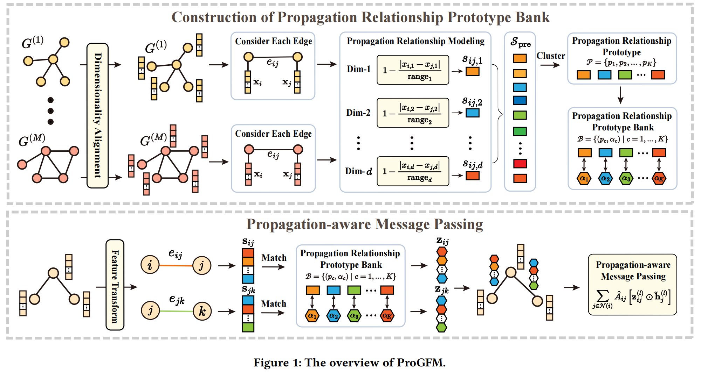

<h1 align="center">Beyond Feature and Structure Alignment:<br>Learning Transferable Propagation Knowledge for Graph Foundation Models</h1>

<div align="center">

**ProGFM: Propagation-aware Graph Foundation Model**

</div>

> 🚧 **Work in progress.** The current code release is incomplete. The full implementation and more detailed documentation are on the way. Stay tuned!

## Overview

<p align="center">
  
</p>

ProGFM treats **propagation relationships between edges and feature dimensions** as transferable knowledge units for graph foundation models. By learning a propagation relationship prototype bank from multiple source domains, ProGFM enables adaptive information aggregation on unseen graph domains.

The framework consists of three main components:

- **Feature Dimensionality Alignment:** Map node features from different domains into a shared dimensional space using SVD.
- **Propagation Relationship Prototype Bank:** Cluster propagation relationships across source graphs and associate each prototype with a learnable propagation strength.
- **Propagation-aware Message Passing:** Adapt information propagation across edges and feature dimensions through prototype matching.

## Code
```text
ProGFM/
├── Dataset_Load.py                 # Dataset loading
├── initial_single_feature.py       # Propagation relationship prototype initialization
├── main_single_feature.py          # Training and few-shot evaluation entry point
└── utils/
    ├── Classifier.py               # Class-prototype classifier
    ├── get_train_test_data.py       # Data preparation and SVD preprocessing
    └── seed.py                     # Random seed setup
```

## Dependencies

The available scripts use Python, PyTorch, PyTorch Geometric, torch-scatter, NumPy, SciPy, and scikit-learn. The current implementation requires CUDA.

